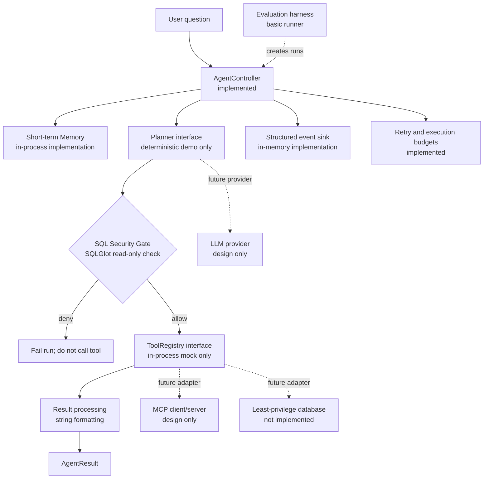

# Architecture

## Agent and security flow

## Execution and recovery notes

Each run creates an `AgentState`, stores the request, calls a planner once, and checks the returned SQL. Only an allowed query reaches the tool registry. Retry is limited to retryable tool errors/timeouts and consumes the tool-call budget; the SQL policy is rechecked only once because retries reuse the same SQL, and a security rejection is never retried. Planner failures and exhausted retries terminate the run. Run timeout cancels the active coroutine and returns `timed_out`.

The in-memory event sink records lifecycle events with run ID, timestamp, status, and coarse error category. It deliberately does not carry question, SQL, or result payloads. The memory store is process-local and should be scoped/cleared appropriately before long-lived deployments.

## Not yet designed as production-ready

Database identity/authorization, prompt injection handling, LLM repair, safe result redaction, production event export, MCP wire protocol, and official evaluation metrics need team decisions and implementation. The current SQL policy is a useful structural baseline, not a substitute for database-enforced permissions or security review.
