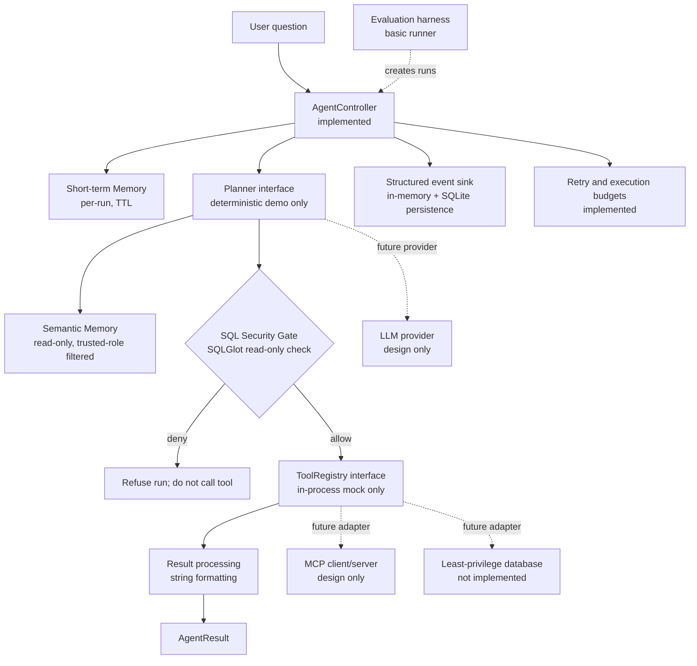

# Architecture

## Agent and security flow

## Execution and recovery notes

Each run creates an independent `AgentState`, retrieves run-scoped context, calls a planner once, and checks the returned SQL before each tool attempt. Only an allowed query reaches the tool registry. Retry is limited to retryable tool errors/timeouts and consumes retry, SQL-attempt, and tool-call budgets; a security rejection is never retried. Security rejection returns `refused`, while planner failures and exhausted retries return a failure. Run timeout cancels the active coroutine and returns `timed_out`.

The event sinks record lifecycle metadata with run ID, UTC timestamp, status, duration, and coarse error category. The Web Query composes the in-memory sink (for its current response) with a SQLite sink (for persistence); configure `SQLGUARD_EVENT_DB_PATH`, which defaults outside the repository to `$XDG_STATE_HOME/sqlguard/events.sqlite3` or `~/.local/state/sqlguard/events.sqlite3`. Events deliberately exclude question, SQL, database path, and result payloads. Memory stores only terminal status, retry counts, and coarse error categories; it does not persist request text, generated SQL, plans, or raw tool results. A memory retrieval failure stops the run before planning. An event sink exception fails the run and prevents subsequent work; terminal event delivery cannot be guaranteed if the sink itself raises.

Semantic Memory is a separate immutable catalog, not part of per-run short-term memory. Its
`d2-semantic-v1` definitions cite the current policy or domain-document references and are
included only when the trusted role can read every required column; an available runtime schema
narrows that set further. Ollama receives the rendered definitions inside an untrusted-data
block, and the security gate remains the authorization boundary. The catalog is tied to policy
version `d2-synthetic-v1`, which the policy currently labels as a draft synthetic schema.

## Not yet designed as production-ready

Database identity/authorization, prompt injection handling, LLM repair, safe result redaction, production event export, MCP wire protocol, and official evaluation metrics need team decisions and implementation. The current SQL policy is a useful structural baseline, not a substitute for database-enforced permissions or security review.
