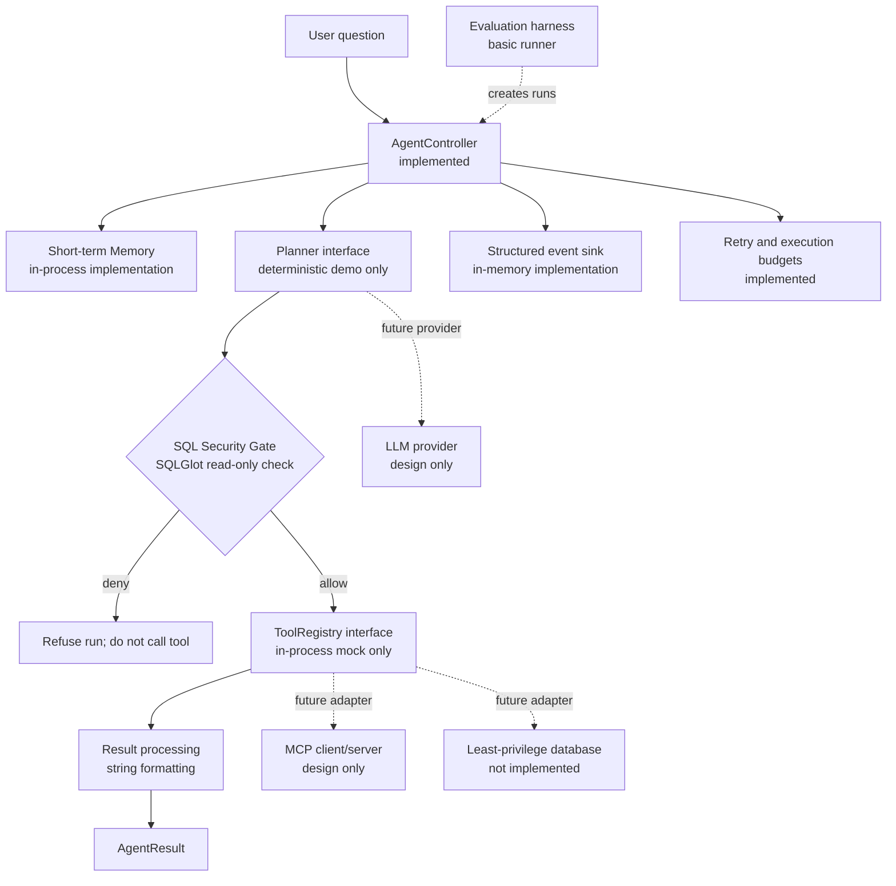

# Architecture

## Agent and security flow

## Execution and recovery notes

Each run creates an independent `AgentState`, retrieves run-scoped context, calls a planner once, and checks the returned SQL before each tool attempt. Only an allowed query reaches the tool registry. Retry is limited to retryable tool errors/timeouts and consumes retry, SQL-attempt, and tool-call budgets; a security rejection is never retried. Security rejection returns `refused`, while planner failures and exhausted retries return a failure. Run timeout cancels the active coroutine and returns `timed_out`.

The in-memory event sink records lifecycle events with run ID, timestamp, status, and coarse error category. It deliberately does not carry question, SQL, or result payloads. Memory stores only terminal status, retry counts, and coarse error categories; it does not persist request text, generated SQL, plans, or raw tool results. A memory retrieval failure stops the run before planning. An event sink exception fails the run and prevents subsequent work; terminal event delivery cannot be guaranteed if the sink itself raises. Both implementations are process-local and should be scoped/cleared appropriately before long-lived deployments.

## Not yet designed as production-ready

Database identity/authorization, prompt injection handling, LLM repair, safe result redaction, production event export, MCP wire protocol, and official evaluation metrics need team decisions and implementation. The current SQL policy is a useful structural baseline, not a substitute for database-enforced permissions or security review.
